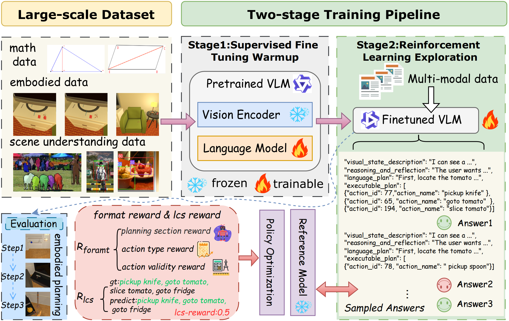

# RoboGPT-R1: Enhancing Robot Planning with Reinforcement Learning

<p align="center">
  <a href="https://arxiv.org/abs/2510.14828">
    
  </a>
  <!-- Update the Hugging Face link and label when the release is available. -->
  <a href="https://huggingface.co/Jinrui137/RoboGPT-R1" style="margin-left:8px;">
    
  </a>
</p>


## Overview


## Installation

RoboGPT-R1 training and evaluation depend on three **independently maintained third-party repositories**:

| Stage | Repository | Purpose |
| --- | --- | --- |
| SFT | [LLaMA-Factory](https://github.com/hiyouga/LLaMA-Factory) | Supervised fine-tuning |
| RFT | [EasyR1](https://github.com/hiyouga/EasyR1) | Reinforcement fine-tuning (the example used in this repository) |
| Evaluation | [EmbodiedBench](https://github.com/EmbodiedBench/EmbodiedBench) | Embodied planning evaluation |

This repository does not include the complete source code of the third-party repositories above. We recommend cloning them alongside RoboGPT-R1. The examples below use `/workspace` as the workspace root:

```text
/workspace
├── Codes
│   ├── RoboGPT-R1/       # this repository
│   ├── LLaMA-Factory/    # SFT
│   ├── EasyR1/           # RFT
│   └── EmbodiedBench/    # Evaluation
├── Datasets/RoboGPT-R1/ 
└── Experiments/RoboGPT-R1/
```

### 1. Clone the third-party repositories


```bash
cd /workspace/Codes
git clone https://github.com/hiyouga/LLaMA-Factory.git
git clone https://github.com/hiyouga/EasyR1.git
git clone https://github.com/EmbodiedBench/EmbodiedBench.git
```

Read and follow the installation instructions of each upstream repository, install its dependencies, and complete its smoke test.

For EmbodiedBench, only install and verify **EB-ALFRED** and **EB-Habitat**. EB-Navigation and EB-Manipulation are not required. Follow the EmbodiedBench documentation to prepare its headless server, simulators, and task data.

> RFT can also be implemented with [verl](https://github.com/volcengine/verl). The RFT configuration files in this repository use EasyR1 as the example implementation; adapting them for verl is your responsibility.


### 2. Create separate Conda environments

For maintainability, create an independent Conda environment for each repository, for example:

| Repository | Environment name | Stage |
| --- | --- | --- |
| LLaMA-Factory | `llama_factory` | SFT |
| EasyR1 | `easyr1` | RFT |
| EmbodiedBench | `embench` | Evaluation |

> The three repositories run independently. However, SFT outputs are used by RFT, so keep core dependency versions—such as `transformers` and `tokenizers`—as consistent as possible between LLaMA-Factory and EasyR1 to reduce compatibility issues.

### 3. Apply the EasyR1 RFT patch

The LCS reward function requires EasyR1 to pass each sample's original prompt to the reward function. After installing EasyR1, run the following command with the directory layout above:

```bash
cd /workspace/Codes/RoboGPT-R1
bash RFT/easyr1_patches/apply_patch.sh /workspace/Codes/EasyR1
```

The script checks whether the patch can be applied before making changes. If the EasyR1 version is incompatible, no files are modified and the script asks you to update the patch. See [RFT/easyr1_patches/README.md](./RFT/easyr1_patches/README.md) for details.

### 4. Install RFT runtime assets

Copy the reward function and prompt template provided by RoboGPT-R1 into EasyR1's `examples/` directory:

```bash
cp /workspace/Codes/RoboGPT-R1/RFT/reward_function/LCS_reward.py \
  /workspace/Codes/EasyR1/examples/reward_function/LCS_reward.py

cp /workspace/Codes/RoboGPT-R1/RFT/rft_no_example.jinja \
  /workspace/Codes/EasyR1/examples/format_prompt/rft_no_example.jinja
```


## Training

After completing installation and preparing the base model, training data, and configuration files, training proceeds in two stages: supervised fine-tuning (SFT) and reinforcement fine-tuning (RFT).

### 1. Create the experiment root directory

```bash
mkdir -p /workspace/Experiments/RoboGPT-R1
```

### 2. SFT

After activating the LLaMA-Factory environment, check the model, data, media, and output paths in [SFT/full_sft.yaml](./SFT/full_sft.yaml). Adjust `CUDA_VISIBLE_DEVICES` and `NPROC_PER_NODE` for your available GPUs, then start training:

```bash
conda activate llama_factory
bash /workspace/Codes/RoboGPT-R1/SFT/full_sft_NV.sh
```

With the example configuration, the SFT model is written to:

```text
/workspace/Experiments/RoboGPT-R1/exp0--only_sft/weight1
```

### 3. RFT

Check the model, data, media, and output paths in [RFT/rft_no_example.yaml](./RFT/rft_no_example.yaml). Then activate the EasyR1 environment and run the migrated launch script:

```bash
conda activate easyr1
bash /workspace/Codes/RoboGPT-R1/RFT/rft_no_example_NV.sh
```


## Model
- **🤗 [Model page (Hugging Face)](https://huggingface.co/Jinrui137/RoboGPT-R1)**

## Dataset
> Coming soon...
